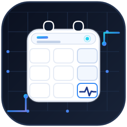

<div align="center">



# 日程桌面 · Open Calendar Desktop

**常驻 Windows 桌面的半透明日程面板 —— 数据只是你自己的 Markdown 文件夹**

[](https://github.com/MrMu666/open-calendar/releases)
[](https://github.com/MrMu666/open-calendar/actions/workflows/release.yml)
[](https://github.com/MrMu666/open-calendar/releases)
[](LICENSE)
[](https://github.com/MrMu666/open-calendar/releases)
[](https://dotnet.microsoft.com/)
[](https://github.com/MrMu666/open-calendar-mobile)

[简体中文](#简体中文) · [English](#english) · [安卓版](https://github.com/MrMu666/open-calendar-mobile) · [下载](#下载与安装)

</div>

---

## 简体中文

### 这是什么

「日程桌面」是一款常驻 Windows 桌面右下角的**半透明玻璃日程面板**：壁纸模糊背景、不抢焦点、不进任务栏。月历、农历、当日日程和未到期事项一眼可见，点一下就能记下待办。

它与常见日程软件最大的不同在**数据形态**：没有数据库、没有账号、没有内置云服务——你的日程就是一堆普通的 Markdown 文件，放在你自己选的文件夹里。

### 功能

| 能力 | 说明 |
| --- | --- |
| 🗓 **月历** | 公历 + 农历同屏；今天之前的日期淡显、相邻月份日期更淡；每月按需 4–6 行、首末行无空白格；事项圆点红 = 未到期、绿 = 已结束 |
| ✅ **事项** | P1–P4 优先级、标签、地点、Markdown 备注、全天 / 时间段；右键「设为长期事项 / 设为已完成 / 删除」 |
| 👁 **两个视图** | 「日历」看选中日期的日程，「事项」看全部未到期事项 |
| 🧹 **自动整理** | 截止后自动归档到 `archive/YYYY/`，删除进 `deleted/`，跨零点自动切到新的一天 |
| 🪟 **桌面集成** | 系统托盘、开机自启、单实例、按「分辨率 + DPI」记住窗口位置与大小 |
| 🎨 **外观** | 背景色、透明度、强调色可调 |

### 纯文本：数据真正属于你

```
我的日程/
├─ items/                                              # 未过期事项
│  └─ 20261109-093000_20261109-180000_P2_项目评审_工作.md
├─ archive/2026/                                       # 过期后自动归档
└─ deleted/                                            # 删除的事项，可恢复
```

文件名本身就是索引：开始时间、截止时间、优先级、标题、标签；文件内容则是 Markdown 备注。因此：

- **不被锁定**——任何文本编辑器、任何脚本都能读写
- **不怕停更**——就算这个项目哪天不维护了，数据仍然完整可读
- **可版本化**——放进 Git 就能 diff、回滚
- **可备份**——复制文件夹就是一份完整备份

### 多端同步：WebDAV / Syncthing

应用只读写本地文件夹，所以任何同步方案都能直接用：

- **Syncthing**：点对点直连、不经过云盘，Windows / Android / Linux 都能装
- **WebDAV**：坚果云、Nextcloud 等，用客户端把该文件夹同步到各设备
- **其他**：OneDrive、iCloud Drive、Dropbox、局域网共享、移动硬盘、Git

**手机端**：配套 Android 版 [open-calendar-mobile](https://github.com/MrMu666/open-calendar-mobile)（Tauri + React），数据格式与桌面端完全一致——把桌面端的 `items/` 拷过去就能用，同样通过 Syncthing / WebDAV 保持同步。

> 小提示：同一时间尽量只在一台设备上编辑；同步工具请保留历史版本，冲突时便于回滚。

### 下载与安装

1. 到 [Releases](https://github.com/MrMu666/open-calendar/releases) 下载 `open-calendar-*-win-x64-setup.exe`
2. 双击安装（自带 .NET 运行时，无需预装）
3. 首次启动时选择一个文件夹作为日程目录；若已用 Syncthing / WebDAV 同步，直接指向那个文件夹即可

系统要求：Windows 10 1809+ / Windows 11，x64。

### 从源码构建

```powershell
dotnet build          # 构建
dotnet test           # 运行测试

# 自包含发布 + 安装包（需要 Inno Setup 6.3+）
dotnet publish src/CalendarApp/CalendarApp.csproj -c Release -r win-x64 --self-contained true -o src/CalendarApp/bin/Release/publish/win-x64
ISCC.exe installer\open-calendar.iss
```

推送 `v*` 标签（如 `v1.1`）会触发 GitHub Actions 自动构建安装包并发布 Release。

### 许可证

[MIT](LICENSE) © 2026 MrMu666

---

## English

### What is it

**Open Calendar Desktop** is a translucent glass calendar panel that lives in the bottom-right corner of your Windows desktop: blurred wallpaper backdrop, never steals focus, never shows in the taskbar. The month grid, lunar dates, the selected day's schedule and all upcoming to-dos are visible at a glance.

What sets it apart is the **data model**: no database, no account, no built-in cloud. Your calendar is a folder of plain Markdown files that you own.

### Features

| | |
| --- | --- |
| 🗓 **Month view** | Gregorian + Chinese lunar dates; past days dimmed, adjacent-month days even fainter; 4–6 rows as needed with no blank cells; dots: red = open items, green = all done |
| ✅ **Items** | P1–P4 priority, tags, location, Markdown notes, all-day / time ranges; right-click to mark long-term / completed / delete |
| 👁 **Two views** | Calendar (selected day) and Tasks (all open items) |
| 🧹 **Auto housekeeping** | Expired items archived to `archive/YYYY/`, deletes go to `deleted/`, the selection rolls to the new day at midnight |
| 🪟 **Desktop integration** | Tray icon, run at startup, single instance, window geometry remembered per resolution + DPI |
| 🎨 **Appearance** | Background color, opacity and accent color |

### Plain text: the data is yours

```
my-calendar/
├─ items/                                              # open items
│  └─ 20261109-093000_20261109-180000_P2_Review_Work.md
├─ archive/2026/                                       # archived after the deadline
└─ deleted/                                            # soft-deleted, recoverable
```

The file name is the index — start time, deadline, priority, title, tags — and the file body is Markdown notes. As a result:

- **No lock-in** — readable and writable by any text editor or script
- **Future-proof** — the data stays readable even if this project is discontinued
- **Versionable** — drop it into Git for diffs and rollbacks
- **Backup-friendly** — copying the folder is a complete backup

### Sync with WebDAV / Syncthing

The app only reads and writes a local folder, so any sync setup works:

- **Syncthing** — peer-to-peer, no cloud, available on Windows / Android / Linux
- **WebDAV** — 坚果云 (Nutstore), Nextcloud, etc.; sync the folder to every device with a client
- **Anything else** — OneDrive, iCloud Drive, Dropbox, LAN shares, external drives, Git

**Android**: the companion app [open-calendar-mobile](https://github.com/MrMu666/open-calendar-mobile) (Tauri + React) uses exactly the same folder format — copy `items/` from the desktop and it just works, with Syncthing / WebDAV keeping both in sync.

> Tip: edit on one device at a time; keep sync history so conflicts can be rolled back.

### Download & install

1. Grab `open-calendar-*-win-x64-setup.exe` from [Releases](https://github.com/MrMu666/open-calendar/releases)
2. Run the installer (the .NET runtime is bundled — nothing else to install)
3. On first launch pick a folder as your calendar directory; if it is already synced via Syncthing / WebDAV, point it at that folder

Requires Windows 10 1809+ / Windows 11, x64.

### Build from source

```powershell
dotnet build          # build
dotnet test           # run tests

# self-contained publish + installer (requires Inno Setup 6.3+)
dotnet publish src/CalendarApp/CalendarApp.csproj -c Release -r win-x64 --self-contained true -o src/CalendarApp/bin/Release/publish/win-x64
ISCC.exe installer\open-calendar.iss
```

Pushing a `v*` tag (e.g. `v1.1`) triggers GitHub Actions to build the installer and publish a release.

### License

[MIT](LICENSE) © 2026 MrMu666
